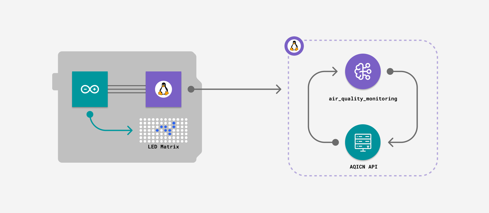
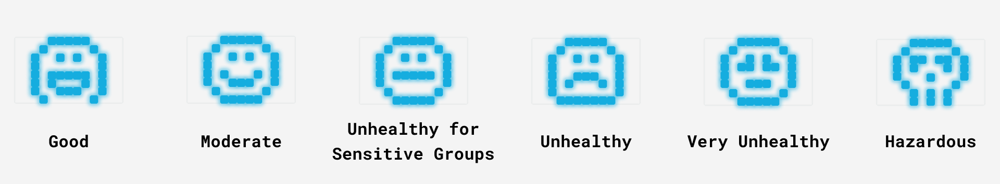
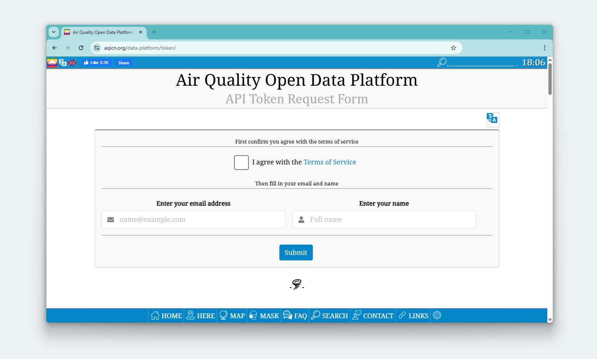
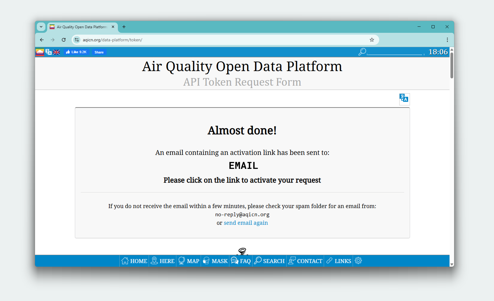
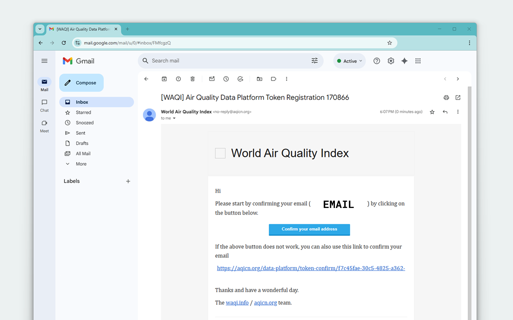
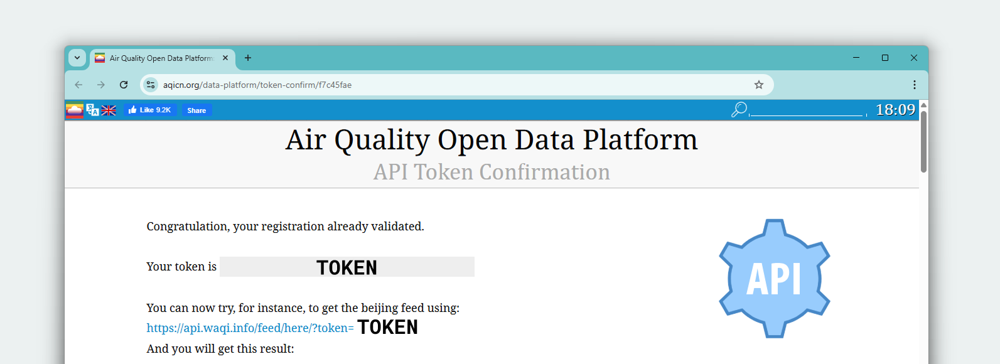
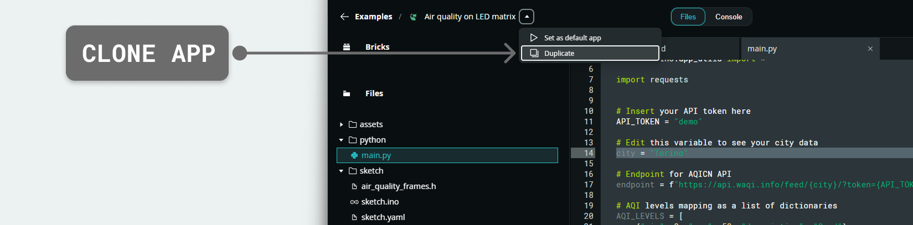

# Air Quality Monitoring App

The **Air Quality Monitoring App** displays real-time air quality data from the *AQICN* service on the board's LED matrix. It displays air quality levels ranging from "Good" to "Hazardous" using animated face patterns that reflect the current air quality, from smiling to distressed.

The images in this file will use the Arduino UNO Q as example.



## Description

The App fetches air quality data from the *AQICN API* for a specified city. It converts numeric AQI values into visual patterns on the 8 x 13 LED matrix. When the air quality changes, the display updates with corresponding emoji icons representing different pollution levels.



The Python® script fetches the data through the Air Quality Monitoring Brick and converts it into an AQI level, while the Arduino sketch manages LED matrix display and polling. The Router Bridge enables communication between the Python environment and the microcontroller.

## Bricks Used

The air quality monitoring example uses the following Bricks:

- `air_quality_monitoring`: Brick to fetch air quality data (AQI) from the AQICN API and map it into categories such as `Good` or `Moderate`.

## Hardware Requirements

### Hardware

- Arduino UNO Q (x1) or Arduino VENTUNO Q (x1)
- [USB-C® cable](https://store.arduino.cc/products/usb-c-cable-24-pin) (for power and programming) (x1) _(only for UNO Q)_

**Note:** You can also run this example using your board as a Single Board Computer (SBC) with a mouse, keyboard and display attached (on the UNO Q through a [USB-C® hub](https://store.arduino.cc/products/usb-c-hub-8-in-1)).

## How to Use the Example

### Obtain an API Token (Required for your city data)

To display air quality data for your specific city, you will need a free API token from AQICN:

1. Visit the AQICN token request page following this link: [https://aqicn.org/data-platform/token/](https://aqicn.org/data-platform/token/)



2. Fill in your details and complete the registration form with:

- Your email address
- Name or organization
- Terms of service agreement



3. Check your email. AQICN will send a confirmation email to the address you provided. Click the confirmation link in the email.



4. After email confirmation, you'll be redirected to a page displaying your unique API token. It will look something like: 
   
 ```bash
a1b2c3d4e5f6g7h8i9j0k1l2m3n4o5p6q7r8s9t0
 ```



### Configure the Application

1. Clone the example to your workspace



2. Update the API token in your code. Open the `main.py` file and locate this line:
   
 ```python
# Insert your API token here
API_TOKEN = "demo"
 ```
   
Replace `"demo"` with your actual API token:
   
 ```python
# Insert your API token here
API_TOKEN = "a1b2c3d4e5f6g7h8i9j0k1l2m3n4o5p6q7r8s9t0"
 ```

3. Set your city. If you want to monitor a different city, update the `city` variable in `main.py`:
   
 ```python
city = "Your City Name"
 ```

### Run the App

Click the **Run** button in the top navigation bar.

## How it Works

Once the application is running, the device performs the following operations:

- **Fetching air quality data from the AQICN API.**

 The Air Quality Monitoring Brick queries the AQICN service for the configured city:

 ```python
monitor = AirQualityMonitoring(token=API_TOKEN)
data = monitor.get_air_quality_by_city(city)
 ```

 The `get_air_quality()` function asks the Brick for the data and handles the `AirQualityLookupError` it raises when the request fails (invalid token, unknown city, quota exceeded).

- **Converting numeric values to readable categories.**

The Brick's `map_aqi_level()` helper converts the numeric AQI into a standard category:

```python
level = AirQualityMonitoring.map_aqi_level(data.aqi)
return level.description if level else "N/A"
```

For example, a pollution reading of 75 is labeled as *Moderate* rather than leaving users to interpret what that number means.

- **Exposing air quality functions to the microcontroller.**

The Router Bridge makes the air quality function callable from the board:

```python
Bridge.provide("get_air_quality", get_air_quality)
```

- **Polling for air quality updates from the board.**

The Arduino sketch calls the Python function once every second:

```arduino
Bridge.call("get_air_quality").result(airQuality)
```

Regular checking ensures the display remains current with changing environmental conditions.

- **Displaying air quality levels on the LED matrix.**

The sketch maps each air quality level to corresponding visual patterns:

```arduino
if (airQuality == "Good") {
    matrixWrite(good);
} else if (airQuality == "Moderate") {
    matrixWrite(moderate);
} // ... additional levels
```

The high-level data flow looks like this:

```
AQICN API → Air Quality Monitoring Brick → Router Bridge → MCU loop() → LED Matrix
```

## Understanding the Code

Here is a brief explanation of the application components:

### 🔧 Backend (`main.py`)

The Python® code serves as the system's data processor, handling all communication with the air quality service and converting raw information into a format that the LED matrix can use.

- **`API_TOKEN`, `city`**: Simple constants that you edit to authenticate with the service and target a different location.

- **`monitor`**: The `AirQualityMonitoring` Brick instance, created with the API token.

- **`AirQualityMonitoring.map_aqi_level()`**: Brick helper that looks up the AQI level (`Good`, `Moderate`, etc.) for a numeric AQI, following standard air quality guidelines.

- **`get_air_quality()`**: Asks the Brick for the air quality of the city, converts the AQI value to its level with `map_aqi_level()` and returns the level description.

- **Error handling**: A failed lookup raises `AirQualityLookupError`, which the function catches so the App keeps running and the matrix shows the `unknown` pattern.

- **`Bridge.provide(...)`**: Makes `get_air_quality` callable from the microcontroller, creating the communication link.

- **`App.run()`**: Starts the Router Bridge runtime that enables the Python®-Arduino communication.

### 🔧 Hardware (`sketch.ino`)

The Arduino code is focused on hardware management. It requests information and displays it.

- **`matrixBegin()`**: Initializes the matrix driver, making the LED display ready to show patterns.

- **`Bridge.begin()`**: Opens the serial communication bridge to the host Python® runtime.

- **`loop()`**: Once per second, calls the Python® function, selects the corresponding 13 × 8 frame (`good`, `moderate`, etc.), and shows it with `matrixWrite(frame)`.

- **`air_quality_frames.h`**: Header file that stores the pixel patterns for each air quality level, plus a fallback `unknown` pattern for error cases.