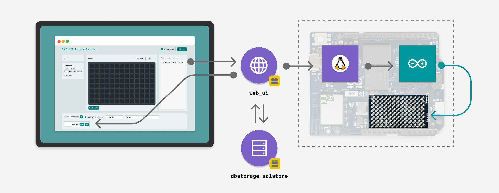

# LED Matrix Painter

The **LED Matrix Painter** example provides a web-based interface to draw, animate, and control the built-in LED Matrix of the Arduino UNO Q in real-time. It features a pixel editor with 3-bit (0-7) brightness control, database storage for your designs, and a code generator to export your frames as ready-to-use C++ code.

*This example is based on the Arduino UNO Q, but also works on the Arduino VENTUNO Q.*



## Description

This App allows you to design visuals for the 8x13 LED matrix directly from your browser. It uses the `web_ui` Brick to host a graphical editor where you can paint individual pixels, adjust their brightness, and apply transformations like flipping or rotating. Every change you make in the browser is immediately reflected on the physical board.

The application uses the `dbstorage_sqlstore` Brick to automatically save your work in a local database. You can create multiple frames, organize them into animations, and use the "Code panel" to see the generated C++ code in real-time.

Key features include:

- **Real-time Control:** Drawing on the web grid updates the matrix instantly.
- **Grayscale Control:** 8 brightness presets (0-7) for intuitive pixel control; this example configures the board for 3-bit grayscale (0–7).
- **Persistent Storage:** Frames are automatically saved to a database, allowing you to build complex animations over time (max 300 frames).
- **Transformation Tools:** Invert, rotate, or flip designs with a single click.
- **Undo/Redo:** Step backward or forward through your editing history.
- **Animation Mode:** Sequence frames to create animations and preview them on the board.
- **Code Export:** Generate `uint32_t` arrays compatible with the `Arduino_LED_Matrix` library for use in standalone sketches.

## Bricks Used

The LED Matrix Painter example uses the following Bricks:

- `web_ui`: Brick to create the interactive grid editor and manage API endpoints.
- `dbstorage_sqlstore`: Brick to persist frames and animation sequences using a SQLite database.

## Hardware Requirements

### Hardware

- Arduino UNO Q (x1) or Arduino VENTUNO Q (x1)
- [USB-C® cable](https://store.arduino.cc/products/usb-c-cable-24-pin) (for power and programming) (x1) _(only for UNO Q)_

## How to Use the Example

1. **Run the App**

   Launch the example by clicking the **Run** button from the top navigation bar.

2. **Access the Editor**

   Open the App in your browser at `<UNO-Q-IP-ADDRESS>:7000`.

3. **Draw Frames**

   - **Paint:** Click any cell in the central grid to turn it on.
   - **Adjust Brightness:** Click an active cell again (or hover/wait) to open the floating slider and set the brightness level (0-7).
   - **Preview:** Observe the UNO Q; the matrix updates instantly as you draw.

4. **Use the Design Tools**

   - **Transform:** Use the **Tools** panel on the left to **Flip Vertically/Horizontally**, **Rotate 180°**, **Invert Matrix** (negative), or **Invert Draw** (brightness).
   - **Undo/Redo:** Use the arrow buttons (◄ ►) next to the Clear Frame button to step backward or forward through your editing history.
   - **Clear:** Use the **Clear Frame** button above the grid to reset the canvas.

5. **Manage Frames (Bottom Panel)**

   - **Auto-save:** Your work is saved to the database automatically.
   - **Create:** Click the **+** button to add a new empty frame.
   - **Edit Details:** Assign a **Name** and **Duration** (in milliseconds) for each frame using the inputs above the frame list.
   - **Reorder:** Drag and drop frame thumbnails to change their sequence.
   - **Load/Delete:** Click a thumbnail to load it. To delete frames, click the **Del** button on individual thumbnails, or select multiple frames (by clicking their thumbnails while holding the selection) and delete them together.
   - **Note:** The application supports up to 300 frames total due to hardware animation buffer limits.

6. **Create Animations**

   - Switch the mode to **Animations** using the radio buttons in the bottom panel.
   - Select multiple frames by clicking on their thumbnails (they will highlight).
   - Click the **Play Animation** button below the grid to preview the sequence on the board.
   - Use the **Stop Animation** button to halt playback at any time.

7. **Export Code**

   - Toggle the **Code panel** switch in the top right header to view the C++ code for the current frame or animation in real-time.
   - Click the **Export .h** button to download a header file containing your selected designs, ready to be included in an Arduino sketch.

## How it Works

The LED Matrix Painter relies on a synchronized data flow between the browser, the Python backend, and the hardware.

**High-level data flow:**

```
Web Browser  ──►  HTTP API  ──►  Python Backend  ──►  Router Bridge  ──►  Arduino Sketch
                                       │                                        │
                                       ▼                                        ▼
                                SQLite Database                          LED Matrix Display
```

1.  **Web Interface**: The `app.js` script captures clicks on the grid. While you draw, it previews the stroke on the board through the `/update_board` endpoint; when you stop, it debounces the changes and saves them via the `/persist_frame` endpoint.

2.  **Python Backend**:

    *   **Data Model**: The `StoredFrame` class pairs a `Frame` from `arduino.app_utils`, which validates and encodes the pixels, with the metadata the app stores, and converts between frontend JSON and database records.
    *   **Persistence**: The `store.py` module uses `SQLStore` to save the frame data to a `frames` table in a SQLite database. The database runs in write-ahead logging mode, and frames are created with a single `INSERT ... RETURNING` statement, so two pages open at the same time cannot create duplicate frames.
    *   **Bridge**: The `main.py` script sends the raw byte array to the board via `Bridge.call("draw", frame_bytes)`.

3.  **Arduino Sketch**: The sketch receives the raw byte data and uses the `Arduino_LED_Matrix` library to render the grayscale image.

## Understanding the Code

### 🔧 Backend (`main.py`, `store.py` & `stored_frame.py`)

The Python backend manages the application logic, database, and hardware communication.

- **Data Model (`stored_frame.py`)**: The `StoredFrame` dataclass holds a `Frame` and adds the metadata of the app: `id`, `name`, `position` and `duration_ms`. The pixels stay in the `Frame`, which validates them against the matrix and encodes them in the formats of the `Arduino_LED_Matrix` library:
  - **API Contract**: `from_payload()` / `to_payload()` format data for the web frontend.
  - **Database Contract**: `from_payload()` / `to_record()` format data for `SQLStore` storage.
  - **Hardware Contract**: `frame.to_bytes()` gives one brightness byte per LED for `matrix.draw()`, and `frame.to_words()` the pixel words of an animation frame for `matrix.loadSequence()`.

```python
@dataclass
class StoredFrame:
    frame: Frame
    id: int | None = None
    name: str = ""
    position: int | None = None
    duration_ms: int = 1000
```

- **Initialization**:
  - `template = FrameDesigner(*UNO_Q_MATRIX, brightness_levels=8)`: Describes the matrix the app draws on, 13x8 LEDs with 8 brightness levels. Every frame is validated against it, and the page reads it from `/config`. The transformations (invert, rotate, flip) are methods of `Frame`.
  - `store.init_db()`: Creates the SQLite database and tables for storing frames if they don't exist.

- **API Endpoints**: The backend exposes several HTTP endpoints using `ui.expose_api` to handle frontend requests:
  - `GET /config`: Returns runtime configuration (brightness levels, matrix dimensions).
  - `POST /update_board`: Updates board display in real-time without persisting to database (live preview while drawing).
  - `POST /persist_frame`: Saves or updates frames in the database and updates the board. The frame is saved even if the board does not answer: the response then reports `board: false`.
  - `POST /load_frame`: Loads a specific frame by ID or retrieves the last edited frame.
  - `GET /list_frames`: Returns all saved frames to populate the bottom panel.
  - `POST /delete_frames`: Deletes multiple frames by their IDs.
  - `POST /reorder_frames`: Reorders frames to match provided ID list order.
  - `POST /bulk_update_duration`: Sets the same duration on all frames.
  - `POST /transform_frame`: Applies geometric transformations (invert, rotate, flip) to the pixel data.
  - `POST /export_frames`: Generates the C++ header file content for frames or animations.
  - `POST /play_animation`: Sends a sequence of frames to the Arduino in acknowledged chunks, then starts the animation.
  - `POST /stop_animation`: Stops any running animation on the board.

- **Hardware Update**: The `draw` function sends the visual data to the microcontroller via the Bridge.

```python
# main.py
def draw(sf: StoredFrame) -> bool:
    try:
        Bridge.call("draw", sf.frame.to_bytes(), timeout=BOARD_TIMEOUT_S)
    except Exception as e:
        logger.warning(f"Board did not draw frame id={sf.id}: {e}")
        return False
    return True
```

- **Code Generation**: The `to_c_array` and `sequence_to_c` functions of `arduino.app_utils.ledmatrix` generate the C++ code displayed in the UI and exported as a `.h` file. A single frame becomes a `uint8_t` array with one brightness value per LED, for `matrix.draw()`; an animation becomes a `uint32_t` array of `{word0, word1, word2, word3, duration}` entries, for `matrix.loadSequence()`.

### 🔧 Arduino Component (`sketch.ino`)

The sketch is designed to be a passive renderer, accepting commands from the Python backend.

- **Grayscale Setup**: The matrix is initialized with 3-bit grayscale support (0-7 brightness levels).

```cpp
void setup() {
  matrix.begin();
  // configure grayscale bits to 3 so the display accepts 0..7 brightness
  // The backend will send quantized values in 0..(2^3-1) == 0..7.
  matrix.setGrayscaleBits(3);
  Bridge.begin();
  Bridge.provide("draw", draw);
  Bridge.provide("load_frames", load_frames);
  Bridge.provide("play_animation", play_animation);
  Bridge.provide("stop_animation", stop_animation);
}
```

- **Providers**: The sketch exposes four Bridge providers:
  - `draw(std::vector<uint8_t>)`: Renders a single frame to the LED matrix.
  - `load_frames(std::vector<uint8_t>)`: Appends a chunk of frames to the animation buffer (5 little-endian `uint32_t` per frame: 4 words + duration) and returns how many frames are buffered.
  - `play_animation()`: Starts playback of loaded animation frames.
  - `stop_animation()`: Halts any running animation.

```cpp
void draw(std::vector<uint8_t> frame) {
  matrix.draw(frame.data());
}

void play_animation() {
  animation_current_frame = 0;
  animation_running = true;
  animation_next_time = millis();
}
```

### 🔧 Frontend (`app.js`)

The JavaScript frontend handles the UI logic and data synchronization.

- **Live preview and Auto-Persist**: While you draw, each change is sent to the board through `/update_board`, with at most one request in flight so a fast stroke never queues a backlog. When you stop, the frame is saved automatically after a short delay (debounce).

```javascript
// Unified persist: save to DB and update board together
function schedulePersist(){
  if (persistTimeout) clearTimeout(persistTimeout);
  persistTimeout = setTimeout(()=> {
    persistFrame();
    persistTimeout = null;
  }, AUTO_PERSIST_DELAY_MS);
}
```

