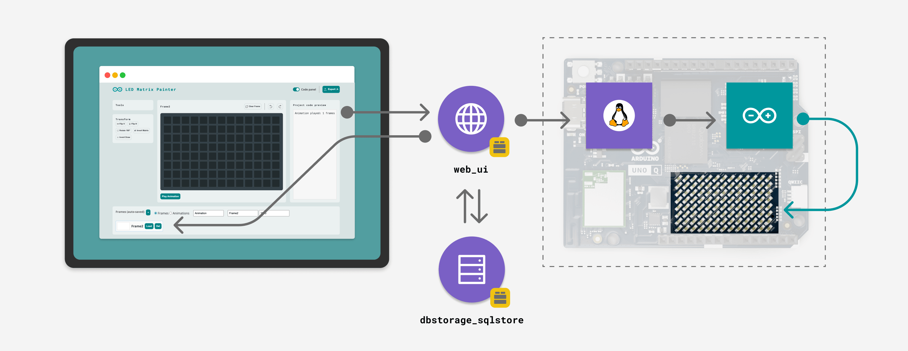

# LED Matrix Painter

The **LED Matrix Painter** example provides a web-based interface to draw, animate, and control the built-in LED Matrix of the Arduino UNO Q in real-time. It features a pixel editor with 3-bit (0-7) brightness control, database storage for your designs, and a code generator to export your frames as ready-to-use C++ code. A toggle switches the editor to an optional Modulino® LED Matrix, with its own size, brightness levels and frames.

*This example is based on the Arduino UNO Q, but also works on the Arduino VENTUNO Q.*



## Description

This App allows you to design visuals for the 8x13 LED matrix directly from your browser. It uses the `web_ui` Brick to host a graphical editor where you can paint individual pixels, adjust their brightness, and apply transformations like flipping or rotating. Every change you make in the browser is immediately reflected on the physical board.

The application uses the `dbstorage_sqlstore` Brick to automatically save your work in a local database. You can create multiple frames, organize them into animations, and use the "Code panel" to see the generated C++ code in real-time.

Key features include:

- **Real-time Control:** Drawing on the web grid updates the matrix instantly.
- **Grayscale Control:** 8 brightness presets (0-7) for intuitive pixel control; this example configures the board for 3-bit grayscale (0–7).
- **Persistent Storage:** Frames are automatically saved to a database, allowing you to build complex animations over time (max 300 frames).
- **Transformation Tools:** Invert, rotate, or flip designs with a single click.
- **Undo/Redo:** Step backward or forward through your editing history.
- **Animation Mode:** Sequence frames to create animations and preview them on the board.
- **Code Export:** Generate `uint32_t` arrays compatible with the `Arduino_LED_Matrix` library for use in standalone sketches.
- **Modulino LED Matrix:** Switch the editor to a 12x8 Modulino LED Matrix with 16 brightness levels. It keeps its own frames and exports code for the `Arduino_Modulino` library.

## Bricks Used

The LED Matrix Painter example uses the following Bricks:

- `web_ui`: Brick to create the interactive grid editor and manage API endpoints.
- `dbstorage_sqlstore`: Brick to persist frames and animation sequences using a SQLite database.

## Hardware Requirements

### Hardware

- Arduino UNO Q (x1) or Arduino VENTUNO Q (x1)
- [USB-C® cable](https://store.arduino.cc/products/usb-c-cable-24-pin) (for power and programming) (x1) _(only for UNO Q)_
- [Modulino® LED Matrix](https://docs.arduino.cc/hardware/modulino-matrix/) and a Qwiic cable (x1) _(optional, to draw on it instead of the board matrix)_

## How to Use the Example

1. **Run the App**

   Launch the example by clicking the **Run** button from the top navigation bar.

2. **Access the Editor**

   Open the App in your browser at `<UNO-Q-IP-ADDRESS>:7000`.

3. **Choose the Matrix**

   The editor starts on the matrix of the board. To draw on a Modulino LED Matrix, connect it to the Qwiic connector and turn on the **Modulino LED Matrix** switch in the top right header: the grid becomes 12x8, the brightness goes from 0 to 15, and the bottom panel lists the frames drawn for the Modulino. Turn the switch off to go back to the board matrix and its frames. The choice is remembered when the App restarts. The Modulino can be connected at any time; while it is missing, frames are still saved and the page reports that the matrix is not responding.

4. **Draw Frames**

   - **Paint:** Click any cell in the central grid to turn it on.
   - **Adjust Brightness:** Click an active cell again (or hover/wait) to open the floating slider and set the brightness level (0-7).
   - **Preview:** Observe the UNO Q; the matrix updates instantly as you draw.

5. **Use the Design Tools**

   - **Transform:** Use the **Tools** panel on the left to **Flip Vertically/Horizontally**, **Rotate 180°**, **Invert Matrix** (negative), or **Invert Draw** (brightness).
   - **Undo/Redo:** Use the arrow buttons (◄ ►) next to the Clear Frame button to step backward or forward through your editing history.
   - **Clear:** Use the **Clear Frame** button above the grid to reset the canvas.

6. **Manage Frames (Bottom Panel)**

   - **Auto-save:** Your work is saved to the database automatically.
   - **Create:** Click the **+** button to add a new empty frame.
   - **Edit Details:** Assign a **Name** and **Duration** (in milliseconds) for each frame using the inputs above the frame list.
   - **Reorder:** Drag and drop frame thumbnails to change their sequence.
   - **Load/Delete:** Click a thumbnail to load it. To delete frames, click the **Del** button on individual thumbnails, or select multiple frames (by clicking their thumbnails while holding the selection) and delete them together.
   - **Note:** The application supports up to 300 frames total due to hardware animation buffer limits.

7. **Create Animations**

   - Switch the mode to **Animations** using the radio buttons in the bottom panel.
   - Select multiple frames by clicking on their thumbnails (they will highlight).
   - Click the **Play Animation** button below the grid to preview the sequence on the board.
   - Use the **Stop Animation** button to halt playback at any time.

8. **Export Code**

   - Toggle the **Code panel** switch in the top right header to view the C++ code for the current frame or animation in real-time.
   - Click the **Export .h** button to download a header file containing your selected designs, ready to be included in an Arduino sketch.

## How it Works

The LED Matrix Painter relies on a synchronized data flow between the browser, the Python backend, and the hardware.

**High-level data flow:**

```
Web Browser  ──►  HTTP API  ──►  Python Backend  ──►  Router Bridge  ──►  Arduino Sketch
                                       │                                        │
                                       ▼                                        ▼
                                SQLite Database                          LED Matrix Display
```

1.  **Web Interface**: The `app.js` script captures clicks on the grid. While you draw, it previews the stroke on the board through the `/update_board` endpoint; when you stop, it debounces the changes and saves them via the `/persist_frame` endpoint.

2.  **Python Backend**:

    *   **Data Model**: The `StoredFrame` class pairs a `Frame` from `arduino.app_utils`, which validates and encodes the pixels, with the metadata the app stores, and converts between frontend JSON and database records.
    *   **Matrices**: The `matrices.py` module describes each matrix the app can draw on: its size and brightness levels, the table of its frames, the sketch providers that drive it and the formats of its Arduino library. The endpoints always work on the selected matrix.
    *   **Persistence**: The `store.py` module uses `SQLStore` to save the frame data in a SQLite database, in one table per matrix: `frames` for the board matrix and `frames_modulino` for the Modulino LED Matrix. A `settings` table remembers the selected matrix. The database runs in write-ahead logging mode, and frames are created one at a time under a lock, so two pages open at the same time cannot create duplicate frames.
    *   **Bridge**: The `main.py` script sends the frame to the board via `Bridge.call`, with the provider and the byte format of the selected matrix: `draw` for the board matrix, `modulino_draw` for the Modulino.

3.  **Arduino Sketch**: The sketch receives the raw byte data and renders the grayscale image with the `Arduino_LED_Matrix` library or, for the Modulino, with the `Arduino_Modulino` library.

## Understanding the Code

### 🔧 Backend (`main.py`, `matrices.py`, `store.py` & `stored_frame.py`)

The Python backend manages the application logic, database, and hardware communication.

- **Data Model (`stored_frame.py`)**: The `StoredFrame` dataclass holds a `Frame` and adds the metadata of the app: `id`, `name`, `position` and `duration_ms`. The pixels stay in the `Frame`, which validates them against the matrix and encodes them in the formats of the `Arduino_LED_Matrix` library:
  - **API Contract**: `from_payload()` / `to_payload()` format data for the web frontend.
  - **Database Contract**: `from_payload()` / `to_record()` format data for `SQLStore` storage.
  - **Hardware Contract**: `frame.to_bytes()` gives one brightness byte per LED for `matrix.draw()`, and `frame.to_words()` the pixel words of an animation frame for `matrix.loadSequence()`.

```python
@dataclass
class StoredFrame:
    frame: Frame
    id: int | None = None
    name: str = ""
    position: int | None = None
    duration_ms: int = 1000
```

- **Matrices (`matrices.py`)**: Each matrix is a small class with what changes from one matrix to another. `UnoQMatrix` is the 13x8 matrix of the board with 8 brightness levels; `ModulinoMatrix` is the 12x8 Modulino LED Matrix in grayscale mode, with 16 levels. The rest of the app only asks the selected matrix, so adding a matrix means adding a class here and its providers to the sketch.

```python
class ModulinoMatrix(Matrix):
    key = "modulino"
    label = "Modulino LED Matrix"
    template = FrameDesigner(MODULINO_MATRIX, brightness_levels=16)
    table = "frames_modulino"
    draw_provider = "modulino_draw"
    load_provider = "modulino_load_frames"

    def draw_payload(self, frame: Frame) -> bytes:
        # 4 bits per LED, the format of ModulinoLEDMatrix::setFrame() in grayscale mode
        pixels = frame.to_bytes()
        return bytes((left << 4) | right for left, right in zip(pixels[0::2], pixels[1::2]))
```

  - `template`: A `FrameDesigner` with the size and the brightness levels of the matrix. Every frame is validated against it, and the page reads it from `/config`. The transformations (invert, rotate, flip) are methods of `Frame`.
  - `table`: The frames of each matrix live in their own table, handled by a `FrameStore` (`store.py`), so the two lists never mix.

- **Initialization**:
  - `store.init_db()`: Creates the SQLite database and the `settings` table.
  - `stores = {key: FrameStore(matrix.table, matrix.template) ...}`: Creates one table of frames per matrix.
  - `selected`: The matrix the page works on, read from the settings and changed by `/select_matrix`.

- **API Endpoints**: The backend exposes several HTTP endpoints using `ui.expose_api` to handle frontend requests:
  - `GET /config`: Returns runtime configuration: the selected matrix with its dimensions and brightness levels, and the available matrices.
  - `POST /select_matrix`: Selects the matrix to draw on, turning the previous one off. The other endpoints then work on its frames.
  - `POST /update_board`: Updates board display in real-time without persisting to database (live preview while drawing).
  - `POST /persist_frame`: Saves or updates frames in the database and updates the board. The frame is saved even if the board does not answer: the response then reports `board: false`.
  - `POST /load_frame`: Loads a specific frame by ID or retrieves the last edited frame.
  - `GET /list_frames`: Returns all saved frames to populate the bottom panel.
  - `POST /delete_frames`: Deletes multiple frames by their IDs.
  - `POST /reorder_frames`: Reorders frames to match provided ID list order.
  - `POST /bulk_update_duration`: Sets the same duration on all frames.
  - `POST /transform_frame`: Applies geometric transformations (invert, rotate, flip) to the pixel data.
  - `POST /export_frames`: Generates the C++ header file content for frames or animations.
  - `POST /play_animation`: Sends a sequence of frames to the Arduino in acknowledged chunks, then starts the animation.
  - `POST /stop_animation`: Stops any running animation on the board.

  When a request cannot be completed (an invalid frame, an unknown id, a board that does not answer), the endpoint returns `{"error": message}` and the page shows the message.

- **Hardware Update**: The `draw` function sends the visual data to the microcontroller via the Bridge, in the format of the matrix.

```python
# main.py
def draw(matrix: Matrix, sf: StoredFrame) -> bool:
    try:
        drawn = Bridge.call(matrix.draw_provider, matrix.draw_payload(sf.frame), timeout=BOARD_TIMEOUT_S)
    except Exception as e:
        logger.warning(f"{matrix.label} did not draw frame id={sf.id}: {e}")
        return False
    return drawn is not False  # the Modulino provider answers False when the module is not connected
```

- **Code Generation**: Each matrix generates the C++ code displayed in the UI and exported as a `.h` file, in the formats of its library:
  - **Board matrix**: The `to_c_array` and `sequence_to_c` functions of `arduino.app_utils.ledmatrix`. A single frame becomes a `uint8_t` array with one brightness value per LED, for `matrix.draw()`; an animation becomes a `uint32_t` array of `{word0, word1, word2, word3, duration}` entries, for `matrix.loadSequence()`.
  - **Modulino LED Matrix**: A single frame becomes a `uint8_t` array of 48 bytes, 4 bits per LED, for `matrix.setFrame()` in `DisplayMode::Grayscale`; an animation becomes a `uint8_t` array of 52-byte entries, each a frame followed by its duration, for `matrix.setSequence()`.

### 🔧 Arduino Component (`sketch.ino`)

The sketch is designed to be a passive renderer, accepting commands from the Python backend. It drives both matrices, so the Python side can switch between them without uploading a new sketch.

- **Grayscale Setup**: The board matrix is initialized with 3-bit grayscale support (0-7 brightness levels). The Modulino LED Matrix is used in grayscale mode (0-15) and is set up at its first use: the sketch checks that it answers on the I2C bus before every write, so it can be connected or removed while the App runs.

```cpp
void setup() {
  matrix.begin();
  // configure grayscale bits to 3 so the display accepts 0..7 brightness
  // The backend will send quantized values in 0..(2^3-1) == 0..7.
  matrix.setGrayscaleBits(3);
  Bridge.begin();
  Bridge.provide("draw", draw);
  Bridge.provide("modulino_draw", modulino_draw);
  Bridge.provide("load_frames", load_frames);
  Bridge.provide("modulino_load_frames", modulino_load_frames);
  Bridge.provide("play_animation", play_animation);
  Bridge.provide("stop_animation", stop_animation);
}
```

- **Providers**: The sketch exposes six Bridge providers:
  - `draw(std::vector<uint8_t>)`: Renders a single frame to the board matrix.
  - `modulino_draw(std::vector<uint8_t>)`: Renders a single frame to the Modulino LED Matrix, and returns `false` when it is not connected.
  - `load_frames(std::vector<uint8_t>)`: Appends a chunk of board matrix frames to the animation buffer (5 little-endian `uint32_t` per frame: 4 words + duration) and returns how many frames are buffered.
  - `modulino_load_frames(std::vector<uint8_t>)`: Appends a chunk of Modulino frames to the same buffer (48 bytes of pixels + a little-endian `uint32_t` duration per frame) and returns how many frames are buffered, or `-1` when the Modulino is not connected.
  - `play_animation()`: Starts playback of loaded animation frames, on the matrix they were loaded for.
  - `stop_animation()`: Halts any running animation.

```cpp
void draw(std::vector<uint8_t> frame) {
  matrix.draw(frame.data());
}

void play_animation() {
  animation_current_frame = 0;
  animation_running = true;
  animation_next_time = millis();
}
```

### 🔧 Frontend (`app.js`)

The JavaScript frontend handles the UI logic and data synchronization.

- **Matrix Toggle**: The page reads the selected matrix from `/config` and builds the grid, the brightness slider and the frame previews for its size and levels. The toggle calls `/select_matrix` and rebuilds the editor with the answer.

- **Live preview and Auto-Persist**: While you draw, each change is sent to the board through `/update_board`, with at most one request in flight so a fast stroke never queues a backlog. When you stop, the frame is saved automatically after a short delay (debounce).

```javascript
// Unified persist: save to DB and update board together
function schedulePersist(){
  if (persistTimeout) clearTimeout(persistTimeout);
  persistTimeout = setTimeout(()=> {
    persistFrame();
    persistTimeout = null;
  }, AUTO_PERSIST_DELAY_MS);
}
```

